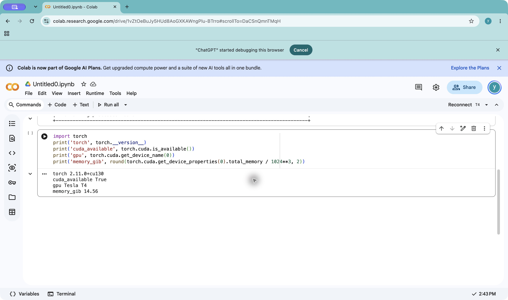

# Colab T4 access preflight

**Checked:** 2026-10-15, approximately 06:42 UTC  
**Account profile:** `yashwant's tech tales` (the designated `y` profile)  
**Notebook:** [Untitled0.ipynb](https://colab.research.google.com/drive/1vZtOeBuJy5HUd8AoGXKAWngPlu-BTrro)

## Result

Colab successfully allocated a Tesla T4 runtime. Two notebook cells confirmed that the GPU was visible to the system and to PyTorch:

- `!nvidia-smi`: NVIDIA-SMI/driver 580.82.07, CUDA 13.0, Tesla T4, 15,360 MiB total memory, 0 MiB in use and 0% utilization at capture.
- PyTorch: `2.11.0+cu130`; `torch.cuda.is_available()` returned `True`; device name `Tesla T4`; PyTorch reported 14.56 GiB total memory.
- The checks completed in 0.493 s and 3.991 s. No model, checkpoint, dataset, or project runner was loaded.
- The runtime was disconnected after the checks. Colab displayed **All changes saved** and **Reconnect T4**, so the two code cells and outputs remain in the Drive notebook while the runtime is off.

## Limits and next step

This verifies that the designated account could obtain a T4 at the time of the check. Colab did not show a per-session charge, compute-unit debit, or other resource-accounting receipt, so this record does not establish whether the allocation drew on free resources or an account benefit. No purchase flow was shown or used.

This was an access and framework preflight, not a LatentGate experiment and it clears no model run by itself. Under the [M1 scope amendment](2026-10-15_m1_smoke_gate_scope_amendment.md), the one-clip unsteered M1 instrumentation smoke is independent of the DiTraj/Kubric human-label Gate 1, but still requires explicit no-paid admission, a refreshed/hash-checked experiment notebook and bundle, and a passing guarded preflight. The versioned [M1 package-stack decision](2026-10-15_m1_package_stack_decision.md) now pins the observed Torch 2.11.0+cu130/TorchVision 0.26.0+cu130 pair; the guarded preflight must verify it before weights load. DiTraj path-control experiments remain blocked on their own human-label gate.
